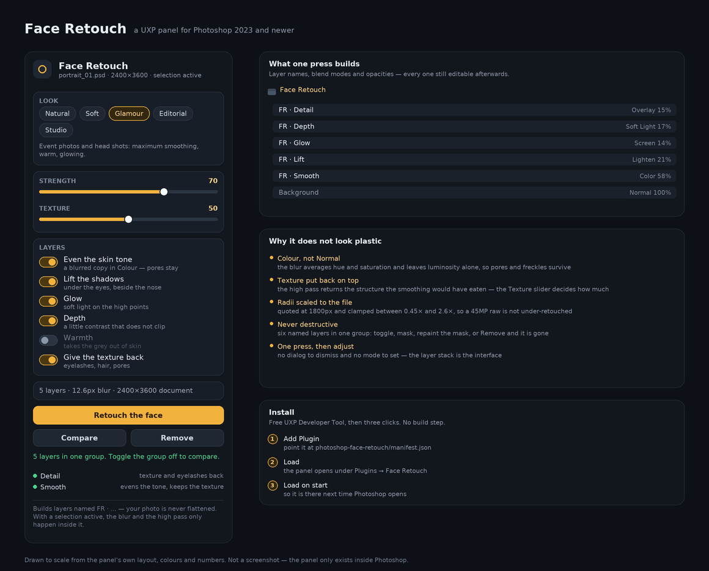

# Face Retouch — a portrait panel for Photoshop

Portrait retouching that leaves the photograph intact. One press builds a stack of
copies of the selected layer and a colour-fill layer — skin tone adjusted, shadows
lifted, warmth added, texture restored — leaving the new layers editable and
removable. The selected source layer is not flattened or painted over.



A UXP plugin: HTML, CSS and JavaScript. No C++ SDK, no build step, no compiler. It
loads in Photoshop through the free UXP Developer Tool and appears under
**Plugins → Face Retouch**.

---

## What you need

| | |
|---|---|
| Photoshop | **2023 (24.0) or newer** — UXP panels are built in from 22.0 |
| UXP Developer Tool | free, from the Creative Cloud desktop app |
| Anything else | nothing. No Node, no Python, no compiler |

Version 1.0.1 targets the Photoshop 2023/2024 APIs and manifest version 5.
Automated tests simulate startup and Photoshop operations; **they do not run
inside Photoshop**. Real-host verification is still needed.

---

## Install / update

1. From **Actions → Face Retouch → a successful run → Artifacts**, download
   `photoshop-face-retouch-plugin`. Extract the ZIP to a local folder (such as
   Documents). `manifest.json`, `index.js`, `src/` and `icons/` must stay together.
2. In Photoshop enable **Edit → Preferences → Plug-ins → Enable Developer Mode**
   (Mac: **Photoshop → Preferences → Plug-ins**), then restart Photoshop.
3. Install/open **UXP Developer Tool** from Creative Cloud Desktop. Start
   Photoshop first and confirm the tool is connected to the intended version.
4. If an older Face Retouch entry exists, **Unload** and remove it from the
   Developer Tool; otherwise it may keep pointing to the old files.
5. Click **Add Plugin**, select the **new extracted** `manifest.json`, then click
   **Load**. Open **Plugins → Face Retouch** in Photoshop. You may need to load
   it again after restarting Photoshop.

This is a development plugin folder, **not a double-click installer or a `.ccx`**.
You can also add `photoshop-face-retouch/manifest.json` from a current repository
checkout. If loading fails, click **Details** in the Developer Tool and share the
exact error or a screenshot. If loading times out, try moving the extracted folder
to local Documents. See the included `INSTALL.txt` for the same steps.

---

## The one button

Open a photo, pick a look, press **Retouch the face**. You get six layers:

| Layer | Blend mode | What it is |
|---|---|---|
| `FR · Detail` | Overlay | A high pass of the photo — pores, eyelashes, hair, the structure the smoothing would otherwise eat |
| `FR · Warmth` | Soft Light | A solid colour fill in a skin tint, at a few percent |
| `FR · Depth` | Soft Light | The photo blended with itself: contrast without clipping |
| `FR · Glow` | Screen | A heavily blurred copy — soft light on the high points |
| `FR · Lift` | Lighten | A blurred copy, pulled back to a low opacity — opens the shadow under the eyes and beside the nose |
| `FR · Smooth` | Color | A blurred copy in **Colour**, the layer this whole thing is built around |

The plugin attempts to collect them into a group called **Face Retouch**; if
Photoshop refuses, check their placement and order in the Layers panel. Toggle a
group off and back on to compare. **Compare** toggles matching layers; **Remove**
asks for confirmation before deleting matching names. These controls use layer names rather than ownership:
inspect the Layers panel first, because your own matching layers can be affected.
Photoshop's History/Undo can also undo the changes, potentially in multiple steps.

### Why the smoothing is in *Colour*

A blurred copy in Colour blend mode averages the **hue and saturation** of the skin
and leaves the luminosity — pores, stubble, freckles, the actual texture — exactly
where it was. That is the difference between "retouched" and "plastic". The
`FR · Detail` layer on top then puts back the high-frequency structure, and the
**Texture** slider decides how much of it survives.

---

## The looks

| Preset | For | Smoothing | Character |
|---|---|---|---|
| **Natural** | when nobody should notice | 5.5 px | keeps pores and freckles |
| **Soft** | magazines, social | 8 px | smooth, texture in the shadows |
| **Glamour** | events, head shots | 12 px | maximum smoothing, warm, glowing |
| **Editorial** | fashion, documentary | 3.5 px | barely smooths, keeps the character |
| **Studio** | commercial, clean | 7 px | even tone, flat light, no glow |

Every preset also carries its own opacities and skin tint, so choosing **Editorial**
does not just blur less — it restores more texture and adds almost no glow.

---

## The two sliders

- **Strength** (0–100) multiplies every opacity and blur radius. At 0 the stack is
  still built, at a whisper; the switches below are how you turn a layer off.
- **Texture** (0–100) decides how much of the high pass comes back. At 0 there is no
  detail layer at all; at 100 skin keeps everything the smoothing would have eaten.

Beneath them, six switches: even the skin tone, lift the shadows, glow, depth,
warmth, give the texture back. Off means the layer is not created — not created and
then hidden.

The line under the switches is live: it is the exact plan for the current document,
before anything is made.

---

## The radii follow the document

Blur radii are quoted at a document **1800 px on the short side** and scaled from
there, clamped between 0.45× and 2.6×. A 600 px web crop gets less blur than a
45-megapixel raw, because 8 px of blur is a lot on one and invisible on the other.

The numbers the tests pin down, for **Natural, strength 60, on an 1800 px photo**:

| Layer | Radius | Opacity |
|---|---|---|
| Detail | 1.9 px high pass | 23 % |
| Warmth | — | 6 % |
| Depth | — | 12 % |
| Glow | 13.6 px | 6 % |
| Lift | 8.8 px | 10 % |
| Smooth | 4 px | 40 % |

---

## Retouching one area only

The plugin does **not** detect faces or automatically create a mask from a
selection. The effects use the selected layer and may affect the whole image;
an active selection can affect filters and fill layers differently.

For a predictable local effect, deselect first, run the retouch, then select the
new **Face Retouch** group. Make a selection of the area in Photoshop and add a
layer mask to the group. If Photoshop could not group the new layers, group them
manually before adding the mask. Adjust or feather the mask as needed.

The selection indicator is a convenience and may be unavailable in Photoshop
2023, whose selection API differs from later versions.

---

## What it deliberately does not do

This is a **tone, texture and light** retoucher. It does not find the face for you,
and it does not reshape it.

Facial-landmark detection and automatic slimming are not in Photoshop's UXP
scripting API. A plugin that claims to "slim the jaw" without seeing the face can only
guess, and a guessed warp on somebody's portrait is worse than no feature at all.
Shape work stays where it belongs — in Photoshop's own tools, non-destructively:

1. Select the face, **Ctrl+J** it to a new layer.
2. Convert it to a smart object (so the warp stays editable).
3. **Filter → Liquify** to taste, or **Edit → Puppet Warp** for the jaw and shoulders.
4. Retouch the tone with this panel afterwards.

Also out of scope, for the same honesty: blemish detection (use the Spot Healing
Brush — it is better at it than any script), teeth whitening and eye colour (a Hue/
Saturation layer and a mask, made in four clicks and *already* editable), and hair
masking.

---

## Testing

```bash
cd photoshop-face-retouch
npm test
```

The Node tests cover retouch plans, descriptors, manifest resources, simulated
UXP HTML startup and panel lifecycle, and fake Photoshop 24/25-style operations
(including read-only `activeLayers`, cancellation and failed layers). The Actions
workflow also runs the startup simulation against the assembled artifact.
**None of these are a real Photoshop load, visual, or image-quality test.**

| File | Purpose |
|---|---|
| `index.js` | plugin-root bootstrap for the panel module |
| `src/core.js` / `src/descriptors.js` | presets, calculations and action descriptors |
| `src/retouch.js` | modal Photoshop adapter and layer management |
| `src/panel.js` | panel UI and controls |
| `tests/startup.test.js` | simulated UXP entry and lifecycle |
| `tests/host-adapter.test.js` | fake Photoshop behavior and safety cases |

---

## When something refuses

Each attempted step reports success or the Photoshop error. An incomplete layer
is deleted when possible; if Photoshop refuses, the panel warns that it was left
hidden or at zero opacity and should be removed manually. A layer that cannot
be grouped is reported instead of being silently treated as grouped. Check the
Layers panel and use History/Undo as needed, especially after cancellation.

**Compare and Remove match names, not ownership.** They can affect any group
named `Face Retouch` or any layer starting with `FR · `, including layers you
created yourself; deleting a matching group also deletes all its contents. The
panel requires a second confirmation for Remove. Rename your own matching
layers or groups before using these controls.

---

## Licence

GPL-2.0-or-later. Copyright © 2026 Emmanuel Suah and the Presence Guard
contributors.
