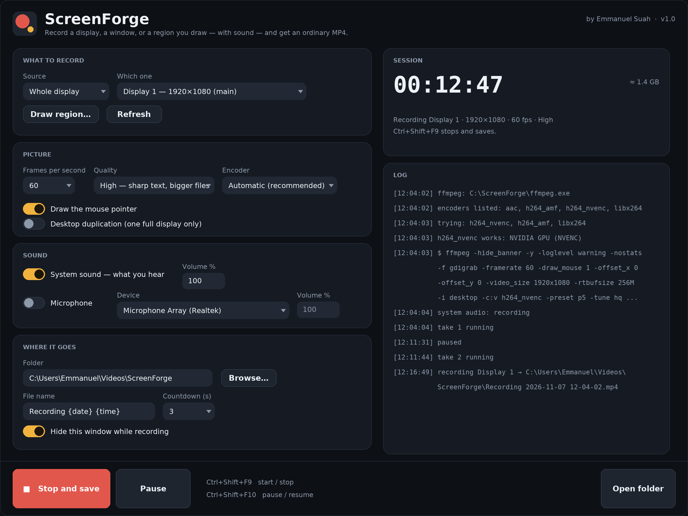

# ScreenForge

A screen recorder for Windows 11 that does the boring parts properly.

Built by **Emmanuel Suah** — that name is the app's publisher in the exe's file
properties, in the header of the window, and in the copyright of every source
file.

One button. It records a display, a window, or a rectangle you draw; it records
what you hear and what you say, mixed with separate volume faders; and it hands
you a normal MP4 that plays anywhere. No watermark, no account, no "upgrade to
export in 1080p".

```
screen-forge/
├── src/            the app (C# / .NET 8, WinForms)
│   ├── Core/       pure logic: args, presets, naming, settings, probing
│   ├── Audio/      WASAPI loopback + microphone, straight to WAV
│   ├── Recording/  takes, pause/resume, mixing, joining, encoding choice
│   ├── Interop/    monitors, windows, hotkeys, sleep
│   └── Ui/         the window, the region picker, the countdown, the chip
└── tests/          the logic tests (they run on Linux in CI, not on your PC)
```

## Get it (no compiler, no Visual Studio)

1. **Actions → ScreenForge → the newest green run**
2. At the bottom, under **Artifacts**: `screenforge-windows-x64`
3. Extract the downloaded ZIP. If it contains another ZIP, extract that too.
   You should see `ScreenForge.exe` and `PUT-FFMPEG-HERE.txt`.
4. **Put `ffmpeg.exe` next to `ScreenForge.exe`** — see below. Without it the app
   starts and politely refuses to record.
5. Double-click `ScreenForge.exe`.

The exe is self-contained: no .NET runtime to install, nothing to register,
nothing in Program Files. A folder on the desktop is fine.

It is unsigned, so SmartScreen will say "Windows protected your PC" the first
time — **More info → Run anyway**. That is what unsigned means; there is no
certificate in this repository's budget.

### The one file you have to fetch

Windows has no built-in way to capture *what your speakers are playing* from a
command line — that has to come through WASAPI, which is why this app carries
NAudio. The picture, however, is captured by ffmpeg, and shipping an 80 MB
binary of somebody else's work inside a git repository is not something I do.

1. <https://www.gyan.dev/ffmpeg/builds/> → **ffmpeg-release-essentials.zip**
2. Open it, copy `bin/ffmpeg.exe` (only that one)
3. Paste it next to `ScreenForge.exe`

Alternatively drop `ffmpeg.exe` anywhere on your `PATH`, or in
`%APPDATA%\ffmpeg\`. The app looks next to itself first, then
`%APPDATA%\ffmpeg`, then `PATH`, and tells you in the log which copy it chose.

## The window



*A drawing of the layout, not a screenshot — every position in it comes from the
same numbers the window uses. There is no Windows desktop here to photograph.*

Three bands, and none of them can be pushed off the screen:

| | |
|---|---|
| **Header** | the name, what the app does, and who made it |
| **Middle** | settings cards on the left (they scroll if the window is short), a big timer and the log on the right |
| **Footer** | Record / Pause / Open folder, always visible, with the hotkeys printed next to them |

The footer is a fixed band rather than the last row of a stack, and the settings
column scrolls, so a 1366×768 laptop at 125% scaling shows exactly the same
things as a 4K desktop. Cards measure themselves from their contents after the
width is known — nothing is positioned by a hand-counted pixel offset.

Everything that draws itself (buttons, switches, cards, the record dot) is
painted in one file, `src/Ui/Controls.cs`, so the whole app shares a palette
instead of mixing themed controls with recoloured stock ones.

## What it does

| | |
|---|---|
| **Sources** | any display (multi-monitor, including screens left of and above the main one), a single window, or a rectangle you draw on the desktop |
| **Frame rates** | 15, 24, 30, 48, 60, 120, 144 |
| **Quality** | Low / Medium / High / Maximum, and the bitrate is derived from the pixels and the frame rate you actually asked for, not a fixed number |
| **Encoders** | NVENC, AMF, Quick Sync, or x264 — picked by encoding a few frames at startup, not by trusting `ffmpeg -encoders` |
| **Audio** | system sound and/or microphone, two independent faders, mixed into one stereo track at the end |
| **Pause** | really pauses: each pause closes a complete file, and the takes are joined when you stop |
| **Safety** | every take is a fragmented MP4 from its first second; a crash or a killed process leaves something recoverable in `%TEMP%\screenforge-*` |
| **Finish** | remuxed with `+faststart`, so it seeks instantly and uploads properly |
| **Countdown** | 0–10 seconds, centred on the thing being recorded, Esc cancels |
| **While recording** | the window hides, the machine is kept awake, a small clock sits on a screen that is *not* being recorded |
| **Naming** | `Recording 2026-11-07 14-32-05.mp4`, with `(2)`, `(3)` on collision; tokens `{date} {time} {source} {quality} {fps}` |
| **Logs** | every recording leaves `yourfile.mp4.log` next to the video with the exact ffmpeg command lines |

### Hotkeys

| | |
|---|---|
| **Ctrl+Shift+F9** | start / stop |
| **Ctrl+Shift+F10** | pause / resume |

Both are registered with Windows, so they work while you are inside the app you
are recording. If another program owns a combination the app says so and the
buttons still work. The tray icon has the same commands plus "show window".

## How it actually records

Two processes, on purpose:

1. **ffmpeg** captures the picture with `gdigrab` (or `ddagrab` when you tick
   "desktop duplication" for a full display) and writes a video-only fragmented
   MP4. No audio muxing means a broken sound device cannot cost you the video.
2. **ScreenForge itself** records system sound through WASAPI loopback and the
   microphone through WASAPI capture, each to its own WAV.

When you stop, ffmpeg mixes the tracks with your faders
(`volume=0.80`, `amix=...:normalize=0`), encodes them to AAC, copies the video
stream untouched, and writes the final file with `+faststart`. Pauses become
separate takes joined by the concat demuxer, so the timer jumps the way you
expect instead of recording an hour of a frozen screen.

### Short recordings and quiet audio

A previous muxing command could shorten the **saved video** to the length of a
shorter audio track. This can happen with WASAPI loopback: an idle playback
device may deliver no audio packets. The 1.0.1 build addresses that in two ways:

* Missing audio intervals are filled according to a monotonic clock when another
  packet arrives, and trailing silence is filled when capture stops. Empty device
  callbacks do not count as packets. Timing is approximate, not sample-accurate.
* The mux pads the audio and stops at the end of the picture. A missing or
  header-only audio file is left out instead of cutting the picture short.

The saved-file dialog tries to read the actual duration back from ffmpeg. It
warns if that is much shorter than the recording session. If ffmpeg itself exits
during a take, ScreenForge stops the timer, tries to save what it has and shows
the error. Failed recordings and their log are retained in a temporary recovery
folder instead of being silently deleted.

The default **3-second countdown happens before recording starts**; it is not a
recording limit. If the window disappears after the countdown, turn off **Hide
this window while recording**, or use the tray icon and Ctrl+Shift+F9 to stop.
If an updated build still stops, keep the `yourfile.mp4.log` next to the video
(or the recovery log named in the error dialog) and share the reported error.

## Where things live

* Settings: `%APPDATA%\ScreenForge\settings.json` — plain JSON, safe to edit.
  A corrupt file is ignored rather than fatal, and every value is clamped on
  load (a frame rate of 47 becomes 48, a volume of 500% becomes 200%).
* Videos: `Videos\ScreenForge\` by default, changeable in the app.
* Temporary takes: `%TEMP%\screenforge-*`, normally deleted after a successful
  save, but retained when recovery may be needed.

## Limits, stated plainly

* **HDR is not supported.** The desktop is captured in 8-bit SDR; an HDR display
  will look washed out until colour conversion is added.
* **One audio output.** System sound means *the default playback device*. If you
  switch output devices mid-recording, the take keeps the old one.
* **Window capture follows the rectangle, not the window.** Move or resize the
  window while recording and the recording keeps the original area — that is a
  property of `gdigrab`, not a bug I can fix with arguments.
* **Region and window capture cannot use desktop duplication**, because
  duplication only exposes whole monitors. Those two modes use `gdigrab`, which
  is slower on a 4K screen at 120 fps.
* A protected-content window (Netflix in a browser, some DRM players) records
  as black, by design of the operating system.
* No webcam overlay, no drawing on the screen, no editing. This records; it does
  not produce.

## Tests

```bash
dotnet test screen-forge/tests/ScreenForge.Tests.csproj
```

The tests cover capture/mux arguments, audio timing, process-exit detection,
settings and file naming. They also run the real ffmpeg against synthetic video
and audio: a video of 8 seconds must retain every frame with no audio, shorter
one/two audio tracks, and audio longer than the video. No Windows, display or
audio device is needed. FFmpeg with libx264 must be on `PATH`, or set the
`SCREENFORGE_FFMPEG` environment variable to its executable path.

The app itself is compiled by the `ScreenForge` workflow on `windows-latest`
into the `screenforge-windows-x64` artifact. **I have not run it on a real
Windows desktop** — no Windows machine here — so the honest claim is: it
compiles, the logic is tested, and the first run on your PC is the first real
run. If something misbehaves, the `%APPDATA%\ScreenForge` settings file and the
`.mp4.log` sidecar next to the video are what to send me.
